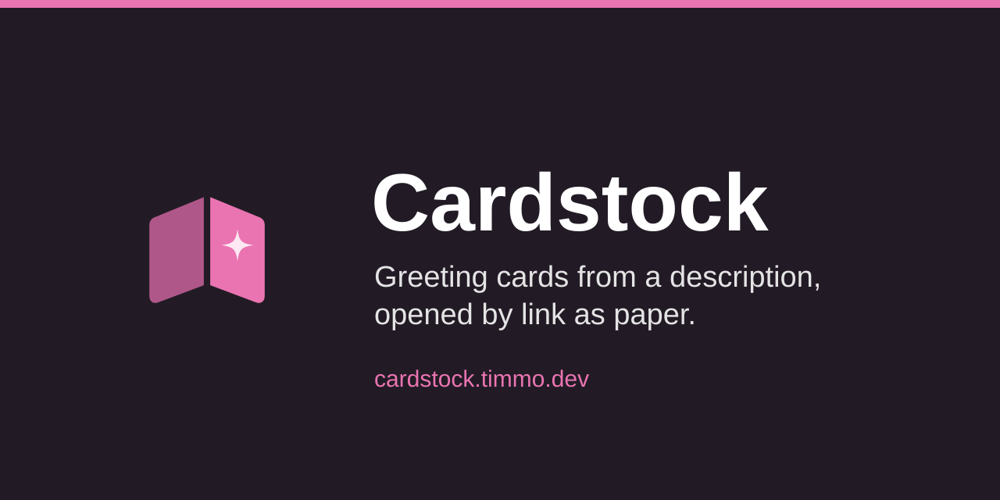

# Cardstock



Greeting cards that open as paper. An agent puts a card together with the
`cardstock` CLI: the words, a design, an effect, and pictures, video and
music from their web addresses. The whole card is sealed into its link, and
opening it shows an envelope that opens into a 3D paper card, drawn with
three.js on WebGPU.

The card and its key ride in the part of the link after `#`, which browsers
never send, so the server stores no cards and never sees one. Whoever has
the link can open the card.

You can make and change cards in the web app on your phone or computer, kept
on that device, edit a copy of any card you're sent, and save one as a
still, an MP4 or a GIF to send in a chat.

See the docs at [cardstock.timmo.dev](https://cardstock.timmo.dev).

## Parts

- [`packages/card`](packages/card): the card format, encryption, renderer,
  designs, effects and exports
- [`packages/app`](packages/app): the web app, with the viewer and editor
- [`packages/server`](packages/server): the Cloudflare Worker that serves the
  app and fetches pictures for sites that block others; it stores nothing
- [`packages/cli`](packages/cli): the `cardstock` CLI, with Code Mode and MCP
  for agents
- [`docs`](docs): the docs site

The card is drawn with [three.js](https://threejs.org) and
[GSAP](https://gsap.com), the code is TypeScript with
[Effect](https://effect.website), and the pages are built on
[Groundwork](https://github.com/timmo001/groundwork).

## Developing

You need [mise](https://mise.jdx.dev):

```sh
mise install
mise run check   # lint, types, formatting and the docs
mise run test
mise run serve:docs
```

Everything on Cloudflare (both Workers, the fetcher's rate limit and its
Turnstile widget) is declared with [Alchemy](https://alchemy.run) in
[`alchemy.run.ts`](alchemy.run.ts). The Deploy workflow deploys it from
`main`; `mise run plan` shows what a deploy would change.
